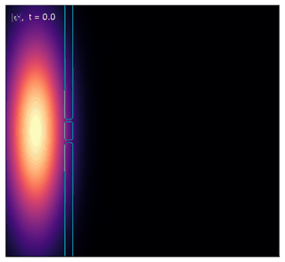
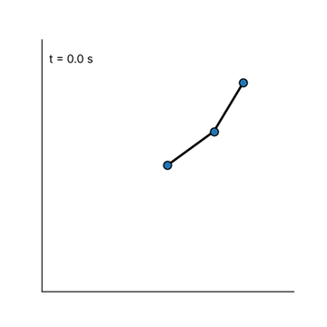
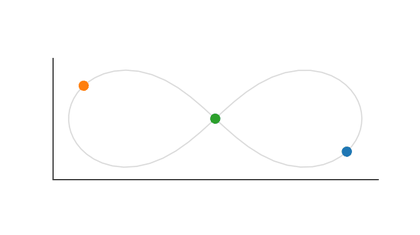
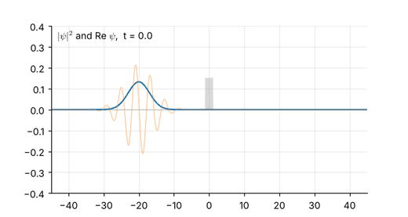
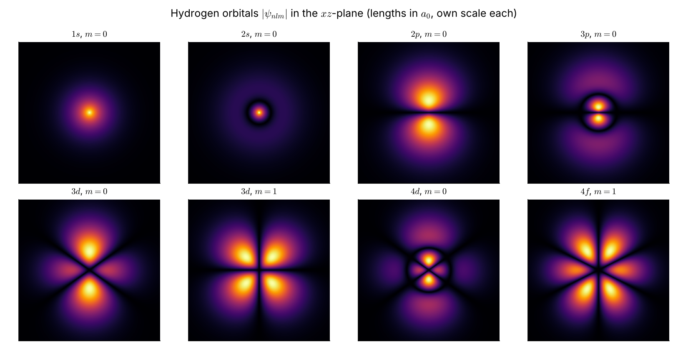
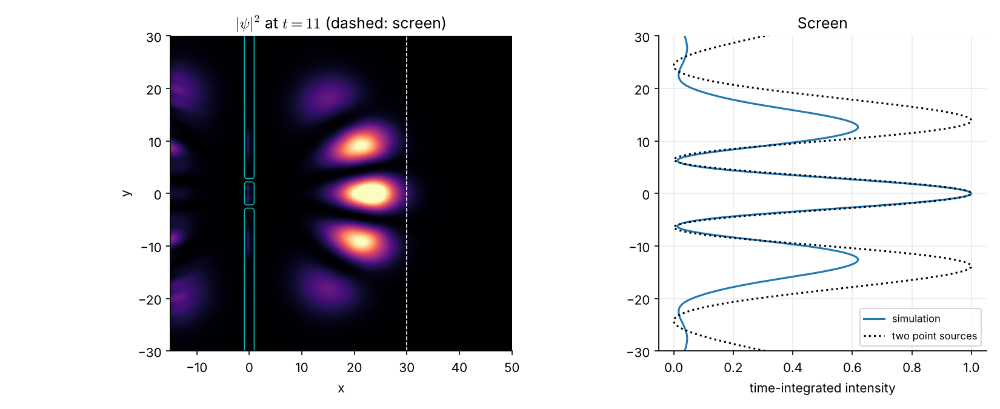
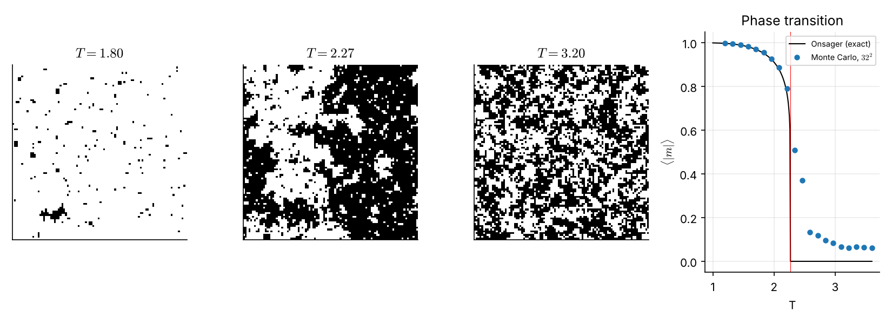
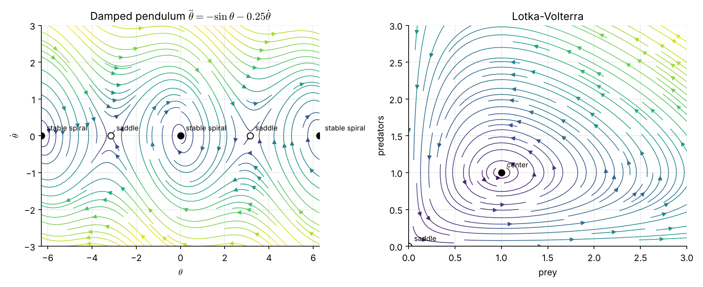
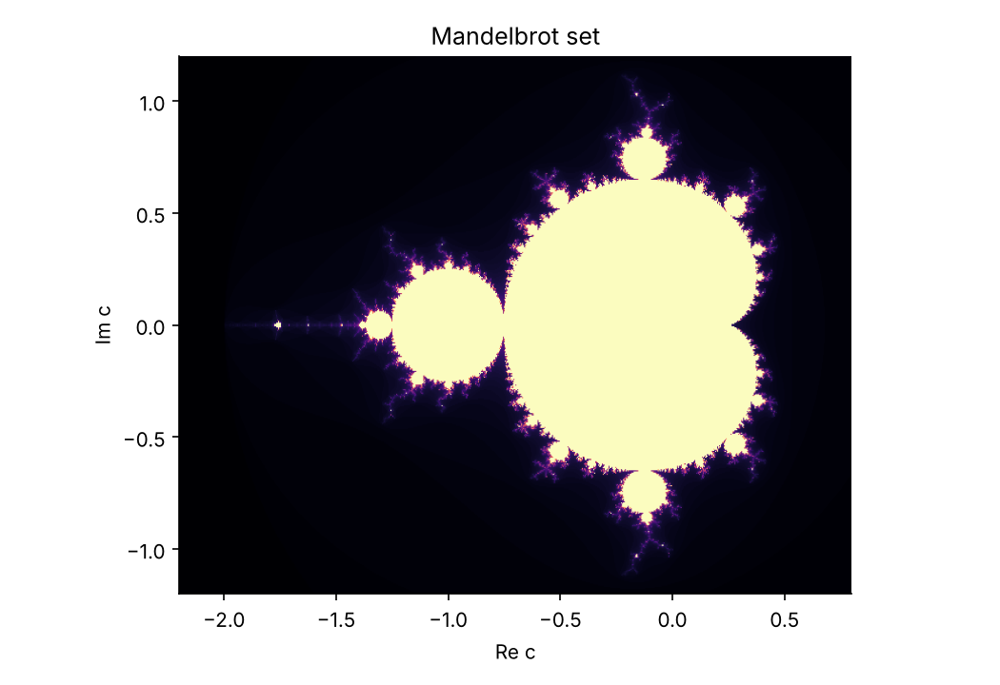
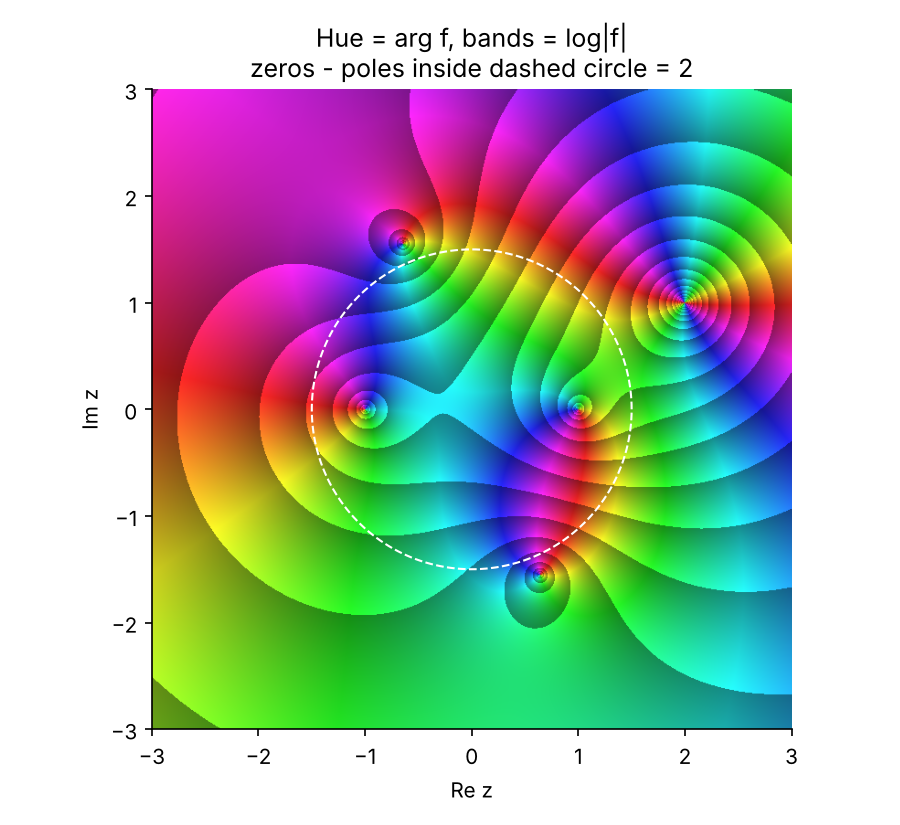

# quantum-playground

[](https://github.com/StativeSh/quantum-playground/actions/workflows/ci.yml)
[](https://stativesh.github.io/quantum-playground/)
[](LICENSE)

A physics and maths playground in Python: simulations, symbolic mechanics and Jupyter notebooks, with tests that check every solver against known analytic results.

**[Website](https://stativesh.github.io/quantum-playground/)**: every figure and animation, the executed notebooks, and an [interactive explorer](https://stativesh.github.io/quantum-playground/explorer/) with sliders for the pendulum, quantum tunnelling and the double slit.

<table>
  <tr>
    <td align="center"><br><sub>Double slit: a 2D Schrödinger simulation</sub></td>
    <td align="center"><br><sub>Chaotic double pendulum</sub></td>
    <td align="center"><br><sub>Three-body figure-eight orbit</sub></td>
  </tr>
</table>



| | |
|---|---|
|  |  |
| Hydrogen orbitals $\lvert\psi_{nlm}\rvert$ | Double-slit fringes against the two-source prediction |
|  |  |
| 2D Ising model against Onsager's exact result | Phase portraits with classified fixed points |
|  |  |
| Mandelbrot set | Domain colouring and the argument principle |

## Quick start

```bash
make install          # venv + editable install + Jupyter kernel
make test             # run the test suite
make demos            # render every demo figure into ./figures
make animations       # render every GIF into ./figures
make lab              # open JupyterLab
```

Or without `make`:

```bash
python3 -m venv .venv
.venv/bin/pip install -r requirements.txt
.venv/bin/qplay list
.venv/bin/qplay run pendulum wavepacket mandelbrot
```

## What is in the box

| Module | Topics |
|---|---|
| `qplay.mechanics` | damped/driven oscillator, nonlinear and double pendulum, projectile with drag, N-body gravity (figure-eight orbit) |
| `qplay.waves` | 1D wave equation, heat equation (Crank-Nicolson), Fourier series, spectra |
| `qplay.em` | point-charge fields, Laplace solver, charged particle in $\mathbf E$ and $\mathbf B$ fields |
| `qplay.quantum` | Schrödinger eigenstates for any 1D potential, split-step dynamics in 1D and 2D with absorbing edges, tunnelling, the double-slit experiment, hydrogen orbitals $R_{nl}Y_l^m$, spin-1/2 |
| `qplay.statmech` | 2D Ising model (Metropolis), Onsager's exact magnetisation and $T_c = 2/\ln(1+\sqrt2)$ |
| `qplay.relativity` | time dilation, length contraction, velocity addition, Lorentz boosts |
| `qplay.chaos` | Lorenz system, logistic map, Lyapunov exponent, Mandelbrot and Julia sets |
| `qplay.symbolic` | SymPy: Lagrangian $\to$ Euler-Lagrange equations $\to$ runnable simulation |
| `qplay.hamiltonian` | Legendre transform, Hamilton's equations, Hamiltonian $\to$ runnable simulation |
| `qplay.dynamics` | phase portraits with automatically classified fixed points (saddle, node, spiral, center) |
| `qplay.complexplane` | domain colouring, argument principle (zeros $-$ poles from a winding number) |
| `qplay.linalg` | Gram-Schmidt, power iteration, how a matrix maps the unit circle (SVD) |
| `qplay.numerics` | bisection, Newton, Simpson, finite differences, Monte Carlo |
| `qplay.integrators` | Euler, RK4, velocity Verlet, adaptive wrapper |

## Notebooks

| Notebook | Contents |
|---|---|
| `01_classical_mechanics` | period vs amplitude, double-pendulum chaos, deriving equations of motion symbolically |
| `02_quantum_mechanics` | oscillator and double-well states, tunnelling, wavepackets, Rabi oscillations |
| `03_maths_and_chaos` | Newton's method, Gibbs phenomenon, bifurcation diagram, fractals |
| `04_orbitals_interference_and_phase_space` | hydrogen orbitals, double slit, Ising phase transition, Legendre transform, phase planes, complex functions, linear maps |

## Lessons for A-level and IB

Guided lessons in `lessons/`, each mapped to specification points, with exam-style questions that check your answers and worked solutions at the end. Every lesson and notebook has an **Open in Colab** button, so it runs in a browser with nothing to install.

| Lesson | Covers |
|---|---|
| [`01_simple_harmonic_motion`](https://colab.research.google.com/github/StativeSh/quantum-playground/blob/main/lessons/01_simple_harmonic_motion.ipynb) | SHM equations and phase, spring and pendulum periods, energy, damping, resonance |

## Demos and animations

`qplay list` shows everything. Twenty static figures (`qplay run NAME`), including `hydrogen`, `double-slit`, `ising`, `phase-portrait`, `domain-coloring` and `linear-map`, and five GIFs (`qplay animate NAME`): `double-pendulum`, `wavepacket`, `figure-eight`, `double-slit` and `ising`.

## Example

Derive the equation of motion of a pendulum from its Lagrangian $L = \tfrac12 m\ell^2\dot\theta^2 + mg\ell\cos\theta$, then simulate it:

```python
import sympy as sp
from qplay import symbolic, integrators

t, m, l, g = sp.symbols("t m l g", positive=True)
th = sp.Function("theta")(t)
L = m * l**2 * sp.diff(th, t)**2 / 2 + m * g * l * sp.cos(th)

symbolic.accelerations(L, [th], t)        # [-g*sin(theta)/l]
rhs = symbolic.to_numeric_rhs(L, [th], t, {m: 1, l: 1, g: 9.81})
t_arr, y = integrators.solve(rhs, [1.0, 0.0], (0, 10))
```

## Adding a demo

```python
# src/qplay/demos.py
@demo("my-demo")
def my_demo():
    """One-line description shown by `qplay list`."""
    fig, ax = plt.subplots()
    ...
    return fig
```

It appears in `qplay list` and is covered by the test suite automatically. Animations work the same way with `@animation("name")` in `src/qplay/animations.py`, returning `(fig, update, frames)`.

## Development

See `CLAUDE.md` for conventions. CI runs the tests on Python 3.10, 3.12 and 3.13 and executes the notebooks.

The website is built by `.github/workflows/pages.yml` on every push to `main`: `scripts/build_site.py` renders all demos and animations, executes the notebooks to HTML and copies the explorer from `site_src/`. Build it locally with `make site` (output in `_site/`). The README images live in `docs/images/` and are regenerated with `make readme-media`.

## License

MIT, see `LICENSE`.
