# quantum-playground

[](https://github.com/StativeSh/quantum-playground/actions/workflows/ci.yml)
[](https://stativesh.github.io/quantum-playground/)
[](LICENSE)

A physics and maths playground in Python: simulations, symbolic mechanics and Jupyter notebooks, with tests that check every solver against known analytic results.

**[Website](https://stativesh.github.io/quantum-playground/)**: every figure and animation, the executed notebooks and lessons, the [API reference](https://stativesh.github.io/quantum-playground/api/), and an [interactive explorer](https://stativesh.github.io/quantum-playground/explorer/) with fourteen live experiments, including pendulum motion, the double slit, radioactive decay and capacitor charging.

<table>
  <tr>
    <td align="center">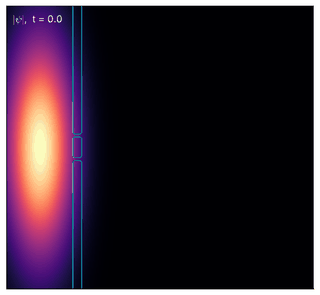<br><sub>Double slit: a 2D Schrödinger simulation</sub></td>
    <td align="center">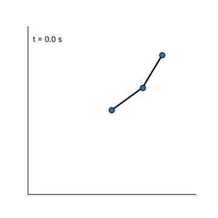<br><sub>Chaotic double pendulum</sub></td>
    <td align="center">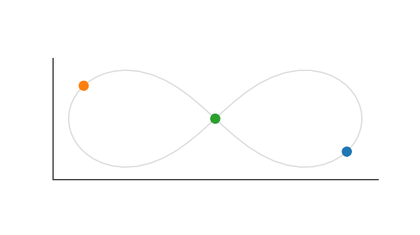<br><sub>Three-body figure-eight orbit</sub></td>
  </tr>
</table>

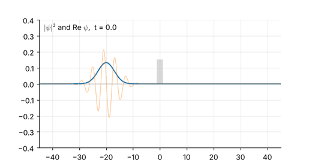

| | |
|---|---|
| 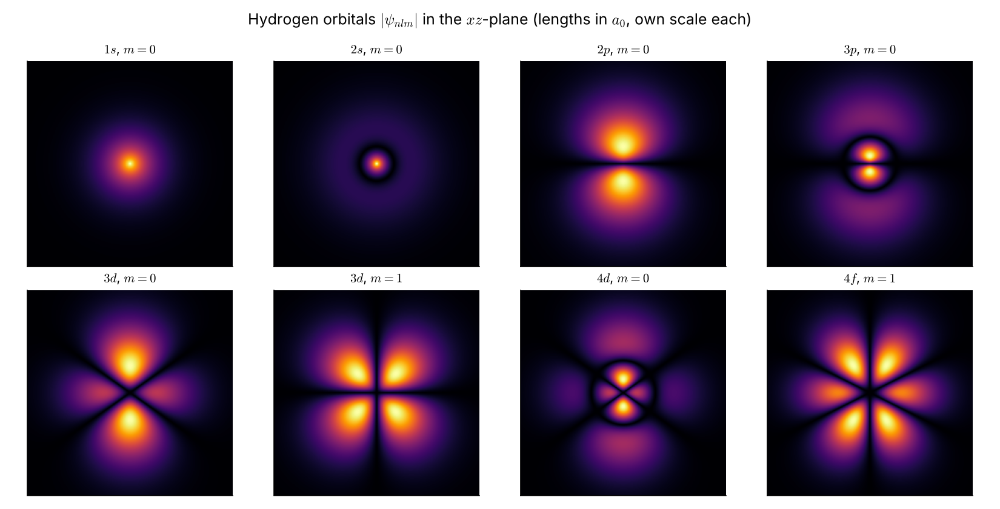 | 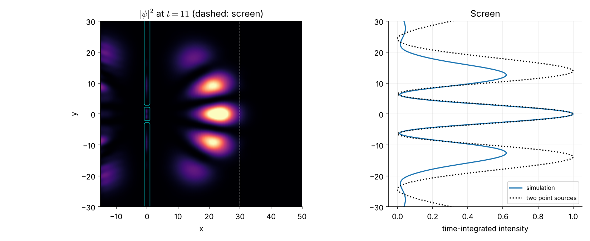 |
| Hydrogen orbitals $\lvert\psi_{nlm}\rvert$ | Double-slit fringes against the two-source prediction |
| 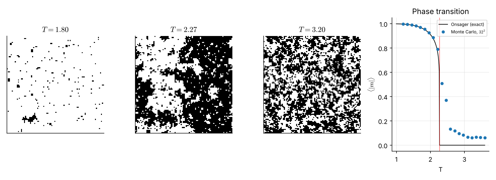 | 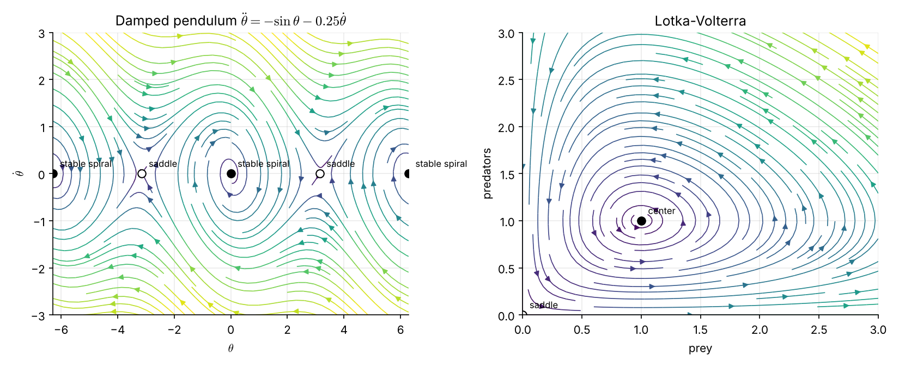 |
| 2D Ising model against Onsager's exact result | Phase portraits with classified fixed points |
| 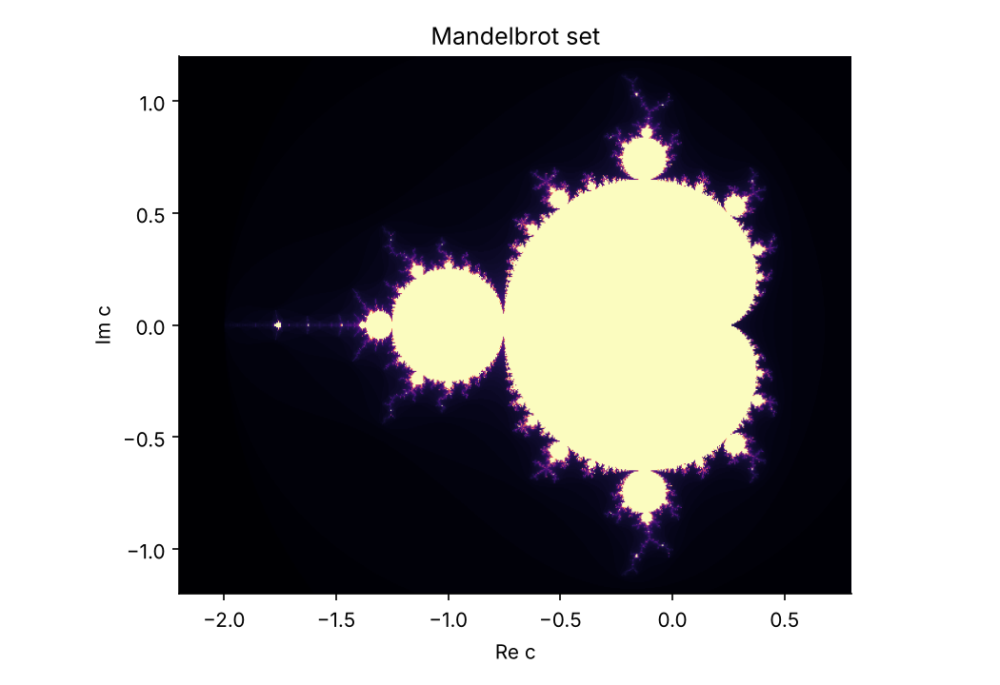 | 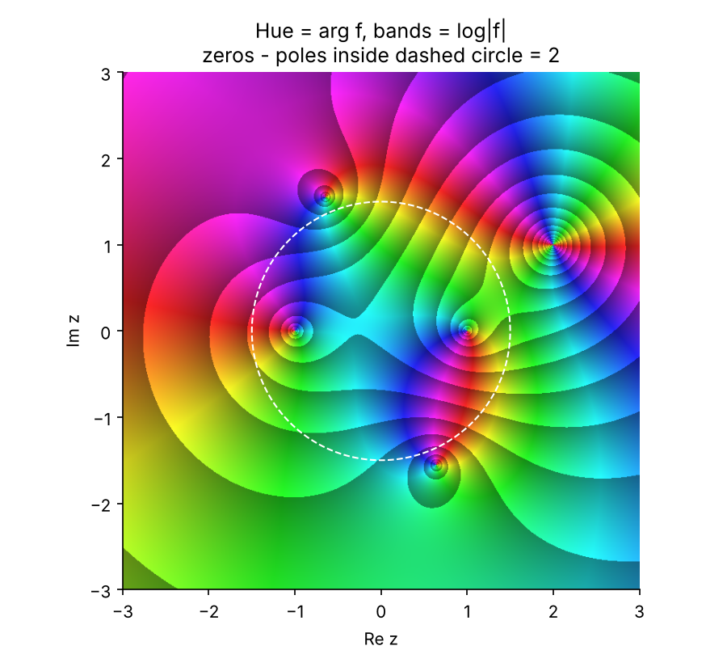 |
| Mandelbrot set | Domain colouring and the argument principle |

## Quick start

```bash
make install          # venv + editable install + Jupyter kernel
make test             # run the test suite
make demos            # render every demo figure into ./figures
make animations       # render every GIF into ./figures
make lab              # open JupyterLab
```

Or just install the package from PyPI (the import name is `qplay`):

```bash
pip install quantum-playground
qplay run double-slit
```

Or from a clone, without `make`:

```bash
python3 -m venv .venv
.venv/bin/pip install -r requirements.txt
.venv/bin/qplay list
.venv/bin/qplay run pendulum wavepacket mandelbrot
```

## What is in the box

| Module | Topics |
|---|---|
| `qplay.mechanics` | damped/driven oscillator, nonlinear and double pendulum, projectile with drag, N-body gravity (figure-eight orbit), smooth-body collisions |
| `qplay.gravity` | point-mass field and potential, escape speed, synchronous orbits |
| `qplay.thermal` | heating through a phase change, Newton cooling |
| `qplay.waves` | 1D wave equation, heat equation (Crank-Nicolson), Fourier series, spectra, grating orders, refraction and thin lenses |
| `qplay.em` | point-charge fields, wire and solenoid fields, induction, Laplace solver, charged particle in $\mathbf E$ and $\mathbf B$ fields |
| `qplay.quantum` | Schrödinger eigenstates for any 1D potential, split-step dynamics in 1D and 2D with absorbing edges, tunnelling, the double-slit experiment, hydrogen orbitals $R_{nl}Y_l^m$, spin-1/2, oscillator eigenstates and coherent states |
| `qplay.atomic` | angular momentum matrices, spin-orbit coupling, Zeeman effect from Landé $g_J$ to Paschen-Back, hydrogen fine structure against the Dirac energy |
| `qplay.kinetic` | hard-sphere gas in a box: Maxwell-Boltzmann distribution emerging from collisions, pressure from wall impulses, $pV = Nk_BT$ with the hard-sphere correction |
| `qplay.nuclear` | half-life, Bateman decay chains, matrix-exponential chains, Monte Carlo decay, binding energy per nucleon |
| `qplay.circuits` | RC charging and discharging, series RLC circuit, impedance, resonance and $Q$ factor |
| `qplay.statmech` | 2D Ising model (Metropolis), Onsager's exact magnetisation and $T_c = 2/\ln(1+\sqrt2)$ |
| `qplay.relativity` | time dilation, length contraction, velocity addition, Lorentz boosts |
| `qplay.chaos` | Lorenz system, logistic map, Lyapunov exponent, Mandelbrot and Julia sets |
| `qplay.symbolic` | SymPy: Lagrangian $\to$ Euler-Lagrange equations $\to$ runnable simulation |
| `qplay.hamiltonian` | Legendre transform, Hamilton's equations, Hamiltonian $\to$ runnable simulation |
| `qplay.dynamics` | phase portraits with automatically classified fixed points (saddle, node, spiral, center) |
| `qplay.complexplane` | domain colouring, argument principle (zeros $-$ poles from a winding number) |
| `qplay.linalg` | Gram-Schmidt, power iteration, how a matrix maps the unit circle (SVD) |
| `qplay.numerics` | bisection, Newton, Simpson, finite differences, Monte Carlo |
| `qplay.integrators` | Euler, RK4, velocity Verlet, adaptive wrapper |

## Notebooks

| Notebook | Contents |
|---|---|
| `01_classical_mechanics` | period vs amplitude, double-pendulum chaos, deriving equations of motion symbolically |
| `02_quantum_mechanics` | oscillator and double-well states, tunnelling, wavepackets, Rabi oscillations |
| `03_maths_and_chaos` | Newton's method, Gibbs phenomenon, bifurcation diagram, fractals |
| `04_orbitals_interference_and_phase_space` | hydrogen orbitals, double slit, Ising phase transition, Legendre transform, phase planes, complex functions, linear maps |

## Lessons for A-level and IB

Guided lessons in `lessons/`, each mapped to specification points, with exam-style questions that check your answers and worked solutions at the end. Every lesson and notebook has an **Open in Colab** button, so it runs in a browser with nothing to install.

Each lesson opens by saying which earlier lessons it builds on (and why) and which it leads to. Before key experiments a **Predict** box asks students to commit to an answer; after the cell runs, an **Explain** box asks them to account for what happened, with answers at the end. Suggested routes:

| Route | Lessons, in order |
|---|---|
| Mechanics | 2 projectile motion → 3 circular motion and orbits → 1 simple harmonic motion |
| Waves to quantum | 1 simple harmonic motion → 4 stationary waves → 7 wave–particle duality |
| Fields | 3 circular motion and orbits → 5 electric fields → 6 charged particles in fields → 11 capacitors |
| Modern physics | 5 electric fields → 7 wave–particle duality → 8 special relativity → 10 radioactive decay |
| Thermal physics | 3 circular motion and orbits → 9 ideal gases and kinetic theory |
| Exponential change | 1 simple harmonic motion → 10 radioactive decay → 11 capacitors |

The prerequisites and routes live in `lessons/path.json`; `python scripts/lesson_path.py --write` copies them into the lesson headers, and the tests check that the two agree.

| Lesson | Covers |
|---|---|
| [`01_simple_harmonic_motion`](https://colab.research.google.com/github/StativeSh/quantum-playground/blob/main/lessons/01_simple_harmonic_motion.ipynb) | SHM equations and phase, spring and pendulum periods, energy, damping, resonance |
| [`02_projectile_motion`](https://colab.research.google.com/github/StativeSh/quantum-playground/blob/main/lessons/02_projectile_motion.ipynb) | independent horizontal and vertical motion, resolving velocity, time of flight, range and the 45° rule, launches from a height, air resistance |
| [`03_circular_motion_and_orbits`](https://colab.research.google.com/github/StativeSh/quantum-playground/blob/main/lessons/03_circular_motion_and_orbits.ipynb) | centripetal acceleration, orbital speed and period, geostationary orbits, Kepler's third law on a log-log plot, orbital energy and escape velocity |
| [`04_stationary_waves`](https://colab.research.google.com/github/StativeSh/quantum-playground/blob/main/lessons/04_stationary_waves.ipynb) | nodes and antinodes, harmonics on a string, why a plucked string is missing some harmonics, open and closed pipes, Fourier series |
| [`05_electric_fields`](https://colab.research.google.com/github/StativeSh/quantum-playground/blob/main/lessons/05_electric_fields.ipynb) | Coulomb's law, field lines and equipotentials, $E = -dV/dr$, uniform fields between plates and edge effects |
| [`06_charged_particles_in_fields`](https://colab.research.google.com/github/StativeSh/quantum-playground/blob/main/lessons/06_charged_particles_in_fields.ipynb) | parabolic paths in $E$, circles in $B$ with $r = mv/BQ$, cyclotron period, velocity selector, mass spectrometer, helices |
| [`07_wave_particle_duality`](https://colab.research.google.com/github/StativeSh/quantum-playground/blob/main/lessons/07_wave_particle_duality.ipynb) | photoelectric effect, Young's double slit, de Broglie wavelength, a simulated electron through two slits, building the pattern one particle at a time |
| [`08_special_relativity`](https://colab.research.google.com/github/StativeSh/quantum-playground/blob/main/lessons/08_special_relativity.ipynb) | postulates, time dilation and the muon experiment, length contraction, velocity addition, relativity of simultaneity, $E = \gamma mc^2$ |
| [`09_ideal_gases_and_kinetic_theory`](https://colab.research.google.com/github/StativeSh/quantum-playground/blob/main/lessons/09_ideal_gases_and_kinetic_theory.ipynb) | gas laws, a simulated gas relaxing to Maxwell-Boltzmann, pressure from collisions, temperature as molecular kinetic energy, when gases stop being ideal |
| [`10_radioactive_decay`](https://colab.research.google.com/github/StativeSh/quantum-playground/blob/main/lessons/10_radioactive_decay.ipynb) | randomness of single decays, $N = N_0e^{-\lambda t}$, half-life from a log graph, counting statistics, decay chains and secular equilibrium, carbon dating |
| [`11_capacitors`](https://colab.research.google.com/github/StativeSh/quantum-playground/blob/main/lessons/11_capacitors.ipynb) | $Q = CV$, parallel plates and dielectrics, energy as the area under $Q$–$V$, discharging and charging through a resistor, the time constant, why half the energy is lost |

Lessons 12–17 extend the course through [collisions](lessons/12_momentum_and_collisions.ipynb), [gravitation](lessons/13_gravitational_fields.ipynb), [induction](lessons/14_electromagnetic_induction.ipynb), [optics](lessons/15_diffraction_gratings_and_optics.ipynb), [thermal transfer](lessons/16_thermal_energy_transfer.ipynb) and [binding energy](lessons/17_nuclear_binding_energy.ipynb). The electromagnetism route follows lessons 5 → 6 → 14 → 11. For numerical methods, work through notebooks 1 → 3 → 2 → 4.

## Versioning and migration

During 1.x, public names in module `__all__` retain compatible calling conventions and return shapes. Minor releases add capabilities, patch releases correct defects, and breaking changes require a major version. Numerical fixes can change incorrect results. See the [migration table](docs/migration.md), [integrator guide](docs/integrators.md) and [release notes](CHANGELOG.md).

## Demos and animations

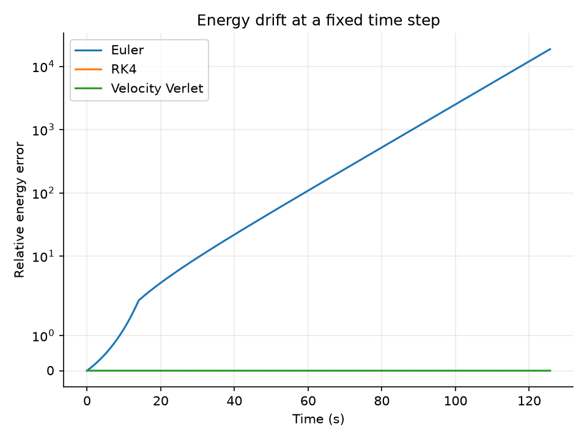

`qplay list` shows everything. Twenty-six static figures (`qplay run NAME`), including `energy-drift`, `hydrogen`, `double-slit`, `ising`, `maxwell-boltzmann`, `coherent-state`, `zeeman`, `decay-chain` and `rlc-resonance`, and six GIFs (`qplay animate NAME`): `double-pendulum`, `wavepacket`, `figure-eight`, `double-slit`, `ising` and `gas`.

## Example

Derive the equation of motion of a pendulum from its Lagrangian $L = \tfrac12 m\ell^2\dot\theta^2 + mg\ell\cos\theta$, then simulate it:

```python
import sympy as sp
from qplay import symbolic, integrators

t, m, l, g = sp.symbols("t m l g", positive=True)
th = sp.Function("theta")(t)
L = m * l**2 * sp.diff(th, t)**2 / 2 + m * g * l * sp.cos(th)

symbolic.accelerations(L, [th], t)        # [-g*sin(theta)/l]
rhs = symbolic.to_numeric_rhs(L, [th], t, {m: 1, l: 1, g: 9.81})
t_arr, y = integrators.solve(rhs, [1.0, 0.0], (0, 10))
```

## Adding a demo

```python
# src/qplay/demos.py
@demo("my-demo")
def my_demo():
    """One-line description shown by `qplay list`."""
    fig, ax = plt.subplots()
    ...
    return fig
```

It appears in `qplay list` and is covered by the test suite automatically. Animations work the same way with `@animation("name")` in `src/qplay/animations.py`, returning `(fig, update, frames)`.

## Development

See `CLAUDE.md` for conventions.

- `make test` is the fast loop: it skips tests marked `slow` (the site build, the biggest simulations and the browser tests). `make test-all` runs everything, and `make coverage` adds a line-by-line coverage report that fails below 95%.
- `tests/test_explorer.py` drives the explorer in headless Chromium: it moves sliders and checks every readout against the Python package or an analytic formula, and lets the animations run to check what they converge to (orbital period, Lorenz separation, Ising magnetisation). Install with `pip install -e ".[browser]"` and `python -m playwright install chromium`, then `make test-browser`. Without Playwright these tests are skipped; CI installs it and fails if the browser is missing.
- CI covers Python 3.10 and 3.12–3.15 on Linux, Python 3.15 on macOS and Python 3.12 on Windows. The oldest-dependency job pins all four runtime libraries. The Linux 3.12 job runs Chromium and executes the notebooks and lessons.
- The website is built by `.github/workflows/pages.yml` on every push to `main`: `scripts/build_site.py` renders all demos and animations, executes the notebooks to HTML, builds the API reference from the docstrings with pdoc, and copies the explorer from `site_src/`. Build it locally with `make site` (output in `_site/`), or just the API reference with `make api`. The README images live in `docs/images/` and are regenerated with `make readme-media`.
- Releases: the distribution is called `quantum-playground` (the import name is still `qplay`; the name `qplay` is taken on PyPI). Pushing a tag such as `v0.3.0` runs `.github/workflows/release.yml`, which checks the tag matches `qplay.__version__`, runs the tests, builds the wheel and publishes it to PyPI through a trusted publisher. `make dist` builds the same files locally.

## License

MIT, see `LICENSE`.
